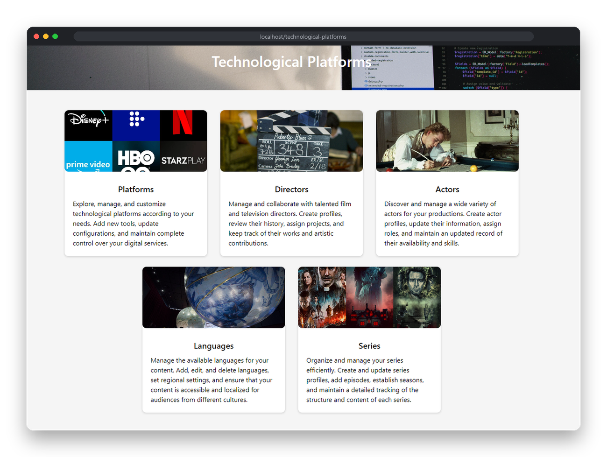
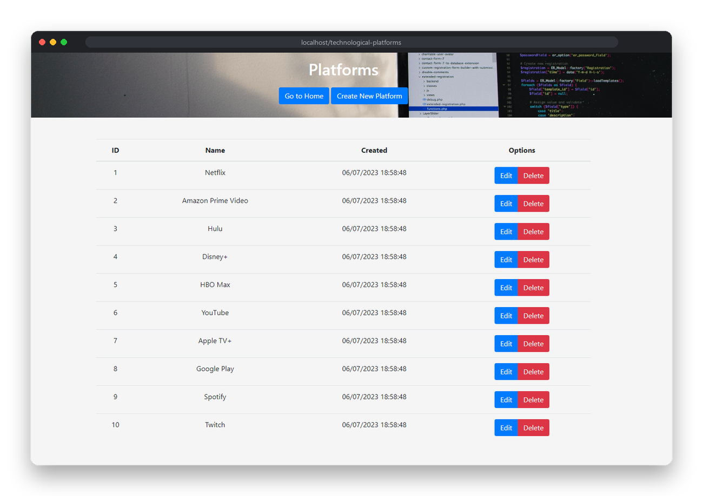
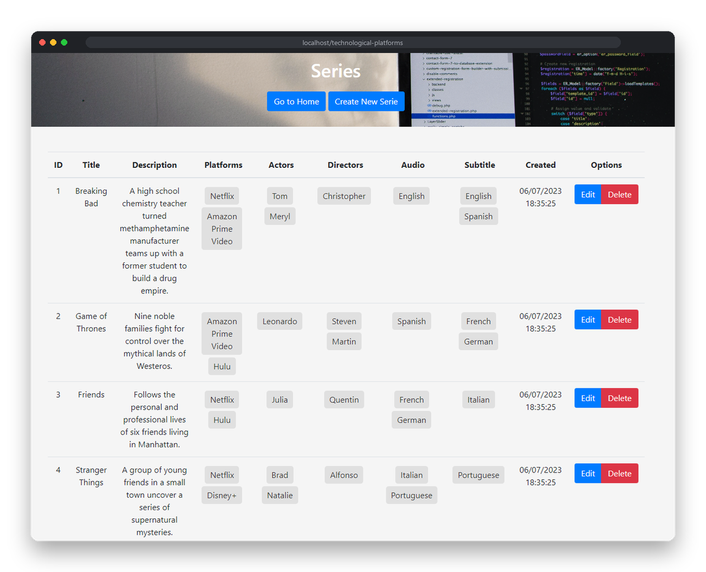
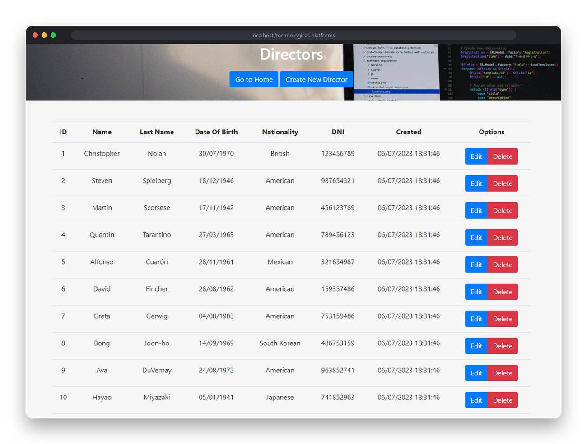
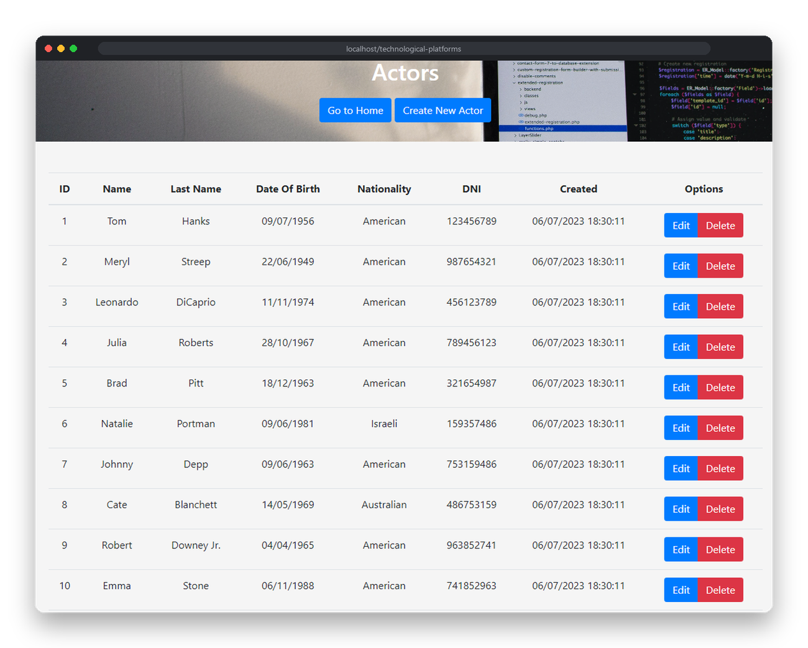

# Technological Platforms 🎬

Web application to manage a streaming catalog (**platforms, directors, actors, languages and series**) with
full CRUD for each entity. Built from scratch in **PHP** following the **MVC** pattern, with **MySQL** and
**Bootstrap**. Developed for the Master's in Web Applications and Services Development at Universidad
Internacional de Valencia (VIU).




## Features

- Five CRUD modules: platforms, directors, actors, languages and series.
- Series with **many-to-many relationships** to platforms, directors, actors, audio languages and subtitle
  languages.
- Database access through PDO with prepared statements.
- Empty-state placeholder when a table has no data.

## Screenshots

| Platforms | Series |
|---|---|
|  |  |
| **Directors** | **Actors** |
|  |  |

## Getting started

Requirements: PHP 8.2 and MySQL (MAMP, XAMPP or similar).

1. Clone the repository into your server's document root.
2. Import [`db_streaming.sql`](db_streaming.sql) into MySQL.
3. Set your database credentials in [`config.php`](config.php).
4. Open `index.php` in the browser.

## Project structure

```
controllers/   # One controller per entity: handles requests and validation
models/        # Database access with PDO
views/         # Bootstrap templates per entity (list, create, edit)
config.php     # Database connection
index.php      # Entry point
```

## License

[GPL-3.0](LICENSE) © Oscar Cuenca · [LinkedIn](https://www.linkedin.com/in/ocuenca-moreno/)
